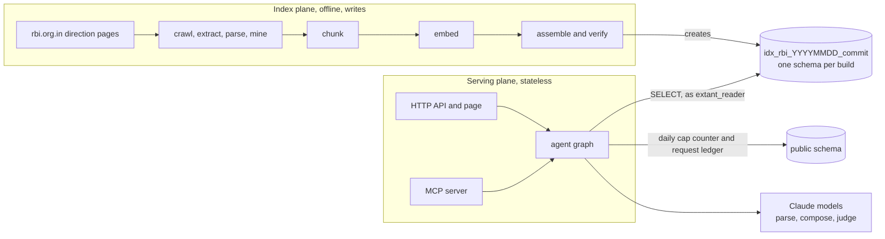

# Extant

Extant answers questions about the Reserve Bank of India's Master Directions for a given type
of regulated entity on a given date. An answer cites the paragraphs it rests on, and every
quote in it has been checked against those paragraphs. When it cannot do that, it refuses and
says why.

**Not legal or tax advice.** Extant reports what the directions say. Whether a provision applies
to a particular set of facts is a judgement for a qualified professional. The section
[Not legal or tax advice](#not-legal-or-tax-advice) says more.

## A corpus where the past can be checked

The RBI publishes the earlier versions of each direction beside the current one, and the version
history dates each change. So a question about what a provision required on a past date has a
right answer, and that answer can be recovered from the regulator's own archive rather than from
anyone's judgement.

Retrieval systems are rarely evaluated on questions about a past date, because few corpora let
anyone check what was true then. This one does. The Phase 1 crawl found 668 versions of 313
directions, 313 of them current and 355 earlier
([`evals/coverage-rbi-20261119.md`](evals/coverage-rbi-20261119.md)). From those versions Phase 3
built a temporal eval set of 288 queries over 158 pairs of consecutive versions. Each pair
contributes one changed paragraph, asked on the last day of the old version and, where the
paragraph survived the amendment, again on the first day of the new one, with that day's
version as the gold ([`evals/ablations.md`](evals/ablations.md)).

That set is the most informative measurement in this repository. Its results lead the retrieval
tables below, and the supersession ablation that leads the results section is the same question
asked of whole answers.

## The problem

On 28 November 2025 the RBI issued notification RBI/2025-26/100. Its text withdraws "9445
circulars listed in the Annex", and the RBI's press release of the same day announced 244 Master
Directions, 7 of them new directions rather than consolidations. The Department of Regulation files those directions under 11
categories of regulated entity. The notification's wording, the 244 and the 11 are recorded in
the Phase 1 reconnaissance report
([`evals/recon-rbi-20261119.md`](evals/recon-rbi-20261119.md)), which also records that the
press release puts the number of circulars consolidated at about 3,500, with the rest identified
as obsolete.

The scraped counts differ from the published ones, and the coverage report says by how much. The
live withdrawal page held 9,458 rows when it was crawled. 9,441 of them predate the notification,
4 short of the published 9,445, and 17 were added afterwards with no withdrawing instrument or
date stated. After 2 duplicate merges the Department of Regulation's withdrawal gold set holds
9,439 rows. The Department of Supervision's later list, RBI/DoS/2026-27/221, adds 628 rows
against 628 published ([`evals/coverage-rbi-20261119.md`](evals/coverage-rbi-20261119.md)). The
244 reconciles exactly by page id, but only by counting 4 dividend directions that were later
withdrawn and replaced ([`evals/recon-rbi-20261119.md`](evals/recon-rbi-20261119.md)).

A compliance policy written before November 2025 may therefore cite circulars that no longer exist,
and the published material does not say where each one went. The notification's annex is a flat
list of withdrawn circulars. It names no direction and no paragraph that replaced any row, so
the share of consolidated directions with a cleanly extractable consolidation annex is 0 of 15
sampled and 0 of all 240 listed under the Department of Regulation
([`evals/coverage-rbi-20261119.md`](evals/coverage-rbi-20261119.md)). Which rule governs a
point, from when and for whom, has to be worked out from the directions themselves.

## What it does

It answers four kinds of question. The examples are real questions from the repository, and the
last column says where each one is.

| Type | Example | Where it is |
|---|---|---|
| Applicability | For an infrastructure project under the PPP model, when may a small finance bank begin disbursing the loan? | `evals/answers/sets/answerable.jsonl`, question `a00`, asked for entity `sfb` |
| Traceback | What replaced circular DOR.ACC.REC.87/21-02-067/2025-26? | `evals/sets/rbi/concordance.p2.jsonl` |
| Diff | How did the minimum capital to risk weighted assets ratio for a small finance bank change between 15 January 2026 and 20 November 2026? | `tests/fixtures/agent/diff_two_dates.json`. No eval set holds a diff question, so this one comes from the recorded agent fixtures and the diff path has no measured result |
| As of | How are NBFCs identified for the upper layer? Asked as of 2026-06-23 and again as of 2026-06-24, with a different version of paragraph 24 as the gold on each date | `evals/answers/sets/as_of.jsonl`, questions `t1-old` and `t1-new` |

### Two planes

An offline index plane writes and a stateless serving plane reads. Each index build creates a
new Postgres schema named for the corpus, the date and the commit, and nothing is ever migrated
in place. Serving connects as a role that can read build schemas and write only the daily cap counter and
the request ledger, and it names the schema it reads. Rolling out a build
means serving a new schema, and rolling back means the previous serving revision, still pointing
at the previous schema. No serving revision has been deployed yet (see [Status](#status)), so
today the schema served is a setting, `EXTANT_BUILD_SCHEMA`.



The serving build is `idx_rbi_20261123_c23c1e8`. Its manifest records 630 documents, 62,920
paragraphs, 67,356 chunks, 31,411 distinct vectors from `openai/text-embedding-3-large` at 256
dimensions in float16, 10,067 withdrawals, 4 concordance rows and 28 entity types. Its four
verification checks found 0 violations each, and its counts match the previous build,
`idx_rbi_20261120_38ede3c`, exactly
([`evals/build-manifest-idx_rbi_20261123_c23c1e8.json`](evals/build-manifest-idx_rbi_20261123_c23c1e8.json)).
The same manifest records `git_dirty` as true. The build was assembled from commit `c23c1e8`
with uncommitted changes in the working tree, so that commit alone does not reproduce it.

Inside the serving plane the agent is an acyclic graph with one routing edge. The entity type
and the date are fixed once, before anything is retrieved. Retrieval filters by both before it
ranks anything. A gate then removes paragraphs that are superseded, not yet effective or outside
the entity scope, and an authority step sets aside support that is only non binding, each with a
recorded row. The one model that writes prose can cite only by index into the candidate list and
must quote verbatim. Five checks run on its output after it finishes. Every citation must be a
candidate, every quote must be a literal substring of the cited paragraph, every number in a
claim must appear in that claim's quotes, nothing cited may be out of force on the date, and the
prose may carry no internal label. A claim with little word overlap with its paragraphs also goes
to a judge model. A claim that fails is withheld, and an answer with nothing left becomes a
refusal. The component READMEs hold the detail, starting with
[`extant/agent/README.md`](extant/agent/README.md).

## Results

The first result is the supersession ablation, because it is the one place where a retrieval
metric and the answers disagree. Taking the supersession gate out raised recall of any version of
the gold paragraph and made answers cite versions that were not in force on the date asked.

The table is lifted from the side by side section of
[`evals/answers.md`](evals/answers.md), run `2026-11-23` on build `idx_rbi_20261123_c23c1e8`, both
splits together. The as_of set is 10 questions on 5 amended provisions, the unanswerable set 37
questions and the answerable set 56.

<!-- lift:supersession -->
| Arm | Recall@10 of the version in force, as_of | Recall@10 of any version, as_of | Cited a version not in force, as_of | Gold cited, as_of | Correct refusals, unanswerable | Recall@10, answerable | Cost p50 (EUR) |
|---|---|---|---|---|---|---|---|
| baseline | 0.90 [0.70, 1.00] | 0.90 [0.70, 1.00] | 0 | 7/10 | 37/37 | 0.98 [0.95, 1.00] | 0.0248 |
| no_supersession | 0.80 [0.50, 1.00] | 1.00 [1.00, 1.00] | 6 | 5/10 | 27/37 | 0.91 [0.82, 0.98] | 0.0155 |
<!-- /lift:supersession -->

On 10 questions the recall intervals overlap, and the project's own rule reports overlapping
intervals as no measurable difference. The counts are the result. Without the gate 6 answers cited
a version not in force on the date asked, against 0 with it, and 27 of 37 unanswerable questions
were refused, against 37 of 37. Of the 10 unanswerable questions it answered, 8 were asked as of
30 June 2025, before the direction governing them came into force, and 2 asked about a provision
deleted before the date asked. That breakdown is counted from
[`evals/answers/runs/2026-11-23/rows.jsonl`](evals/answers/runs/2026-11-23/rows.jsonl) against
the reason each question carries in
[`evals/answers/sets/unanswerable.jsonl`](evals/answers/sets/unanswerable.jsonl). The arm without
the gate was also the cheapest, at a median of EUR 0.0155 a question against EUR 0.0248.
[`docs/entity-filter-and-supersession.md`](docs/entity-filter-and-supersession.md) works through
this result and the entity filter result in five minutes.

### Retrieval, per eval set

Every table below is one set on one split, never pooled across sets. Intervals are 95 percent
bootstrap intervals. The full tables, with recall at 5 and 20 and the memorisation holdout, are in
[`evals/ablations.md`](evals/ablations.md). Arms whose corpus is the sample ran on 224 of the 630
documents, where recall is easier, so they compare only with each other.

**Temporal.** Paragraph level. Label precision 0.96 on 50 audited pairs. The audit was done by
Claude, checking each pair by script against the raw cached RBI pages and reading every pair that
failed a check, and not by a person, so it is weaker evidence than a hand audit.

Dev split

<!-- lift:temporal-dev -->
| Arm | Corpus | n | Recall@1 | Recall@10 | MRR | Document recall@10 | Entity violations | As of violations | Differs from its reference arm at |
|---|---|---|---|---|---|---|---|---|---|
| `hybrid` | full | 160 | 0.919 [0.875, 0.956] | 0.988 [0.969, 1.000] | 0.944 [0.915, 0.971] | 1.000 [1.000, 1.000] | 0 of 7172 | 0 of 7172 | reference |
| `dense-only` | full | 160 | 0.775 [0.713, 0.838] | 0.950 [0.912, 0.981] | 0.836 [0.788, 0.883] | 0.975 [0.950, 0.994] | 0 of 7084 | 0 of 7084 | para@1, doc@5, doc@10, doc@20, para_ctx@1 |
| `lexical-only` | full | 160 | 0.831 [0.769, 0.887] | 0.919 [0.875, 0.963] | 0.865 [0.815, 0.914] | 0.919 [0.875, 0.963] | 0 of 1351 | 0 of 1351 | para@5, para@10, para@20, doc@5, doc@10, doc@20, para_ctx@5, para_ctx@10, para_ctx@20 |
| `post-filter` | full | 160 | 0.875 [0.819, 0.925] | 0.956 [0.925, 0.988] | 0.910 [0.869, 0.947] | 0.975 [0.950, 0.994] | 0 of 2858 | 0 of 2858 | doc@5, doc@10, doc@20 |
| `no-expansion` | full | 160 | 0.919 [0.875, 0.956] | 0.988 [0.969, 1.000] | 0.944 [0.915, 0.971] | 1.000 [1.000, 1.000] | 0 of 3200 | 0 of 3200 | none |
| `s-hybrid` | sample, 224 of 630 documents | 112 | 0.893 [0.830, 0.946] | 0.991 [0.973, 1.000] | 0.933 [0.890, 0.967] | 1.000 [1.000, 1.000] | 0 of 2240 | 0 of 2240 | reference |
| `s-hybrid-rerank` | sample, 224 of 630 documents | 112 | 0.804 [0.723, 0.866] | 0.982 [0.955, 1.000] | 0.879 [0.830, 0.924] | 0.991 [0.973, 1.000] | 0 of 2240 | 0 of 2240 | doc@5 |
| `s-dense-256-f16` | sample, 224 of 630 documents | 112 | 0.732 [0.652, 0.812] | 0.973 [0.938, 1.000] | 0.819 [0.761, 0.873] | 0.991 [0.973, 1.000] | 0 of 2240 | 0 of 2240 | reference |
| `s-dense-1024-f32` | sample, 224 of 630 documents | 112 | 0.714 [0.625, 0.795] | 0.991 [0.973, 1.000] | 0.812 [0.754, 0.867] | 0.991 [0.973, 1.000] | 0 of 2240 | 0 of 2240 | none |
| `s-dense-1024-binary` | sample, 224 of 630 documents | 112 | 0.714 [0.625, 0.795] | 0.991 [0.973, 1.000] | 0.812 [0.754, 0.867] | 0.991 [0.973, 1.000] | 0 of 2240 | 0 of 2240 | none |
| `s-dense-bge-m3` | sample, 224 of 630 documents | 112 | 0.688 [0.598, 0.768] | 0.946 [0.902, 0.982] | 0.773 [0.708, 0.835] | 0.982 [0.955, 1.000] | 0 of 2240 | 0 of 2240 | none |
<!-- /lift:temporal-dev -->

Test split, evaluated once

<!-- lift:temporal-test -->
| Arm | Corpus | n | Recall@1 | Recall@10 | MRR | Document recall@10 | Entity violations | As of violations | Differs from its reference arm at |
|---|---|---|---|---|---|---|---|---|---|
| `hybrid` | full | 128 | 0.898 [0.844, 0.945] | 0.992 [0.977, 1.000] | 0.932 [0.894, 0.965] | 0.992 [0.977, 1.000] | 0 of 5930 | 0 of 5930 | reference |
| `dense-only` | full | 128 | 0.742 [0.664, 0.812] | 0.938 [0.891, 0.977] | 0.813 [0.755, 0.866] | 0.961 [0.922, 0.992] | 0 of 5857 | 0 of 5857 | para@1, para@5, doc@5, para_ctx@1, para_ctx@5 |
| `lexical-only` | full | 128 | 0.828 [0.758, 0.891] | 0.891 [0.836, 0.945] | 0.853 [0.791, 0.907] | 0.891 [0.836, 0.945] | 0 of 872 | 0 of 872 | para@5, para@10, para@20, doc@5, doc@10, doc@20, para_ctx@5, para_ctx@10, para_ctx@20 |
| `post-filter` | full | 128 | 0.859 [0.797, 0.914] | 0.961 [0.922, 0.992] | 0.901 [0.855, 0.942] | 0.969 [0.930, 0.992] | 0 of 1932 | 0 of 1932 | none |
| `no-expansion` | full | 128 | 0.898 [0.844, 0.945] | 0.992 [0.977, 1.000] | 0.932 [0.894, 0.965] | 0.992 [0.977, 1.000] | 0 of 2560 | 0 of 2560 | none |
<!-- /lift:temporal-test -->

On both splits the hybrid arm measurably beats dense alone at paragraph recall at 1, and lexical
alone at paragraph recall at 5, 10 and 20. The post filter arm is the subject of the short post.

**Withdrawal.** Document level. Label precision 1.00 on 50 pairs, audited by Claude in the same
way. All five full corpus arms score identically on both splits. A hit can come only from the
deterministic reference lookup, because the withdrawing notifications that are the labels are not
themselves in the index, so the ranking arms cannot change the score. Only the hybrid row is
shown.

<!-- lift:withdrawal -->
| Split | Corpus | n | Recall@1 | Recall@10 | MRR | Document recall@10 | Entity violations | As of violations |
|---|---|---|---|---|---|---|---|---|
| dev | full | 487 | 0.943 [0.922, 0.963] | 0.943 [0.922, 0.963] | 0.943 [0.922, 0.963] | 0.943 [0.922, 0.963] | 0 of 527 | 0 of 527 |
| test | full | 513 | 0.922 [0.899, 0.945] | 0.922 [0.899, 0.945] | 0.922 [0.899, 0.945] | 0.922 [0.899, 0.945] | 0 of 905 | 0 of 905 |
<!-- /lift:withdrawal -->

**Concordance.** Document level. Label precision 1.00 on 4 pairs, audited by Claude in the same
way. Four queries exist in the whole corpus, so no number here means anything. The set is kept so
the gap shows. Only the hybrid row is shown, and every arm matches it.

<!-- lift:concordance -->
| Split | Corpus | n | Recall@1 | Recall@10 | MRR | Document recall@10 | Entity violations | As of violations |
|---|---|---|---|---|---|---|---|---|
| dev | full | 1 | 1.000 [1.000, 1.000] | 1.000 [1.000, 1.000] | 1.000 [1.000, 1.000] | 1.000 [1.000, 1.000] | 0 of 2 | 0 of 2 |
| test | full | 3 | 1.000 [1.000, 1.000] | 1.000 [1.000, 1.000] | 1.000 [1.000, 1.000] | 1.000 [1.000, 1.000] | 0 of 6 | 0 of 6 |
<!-- /lift:concordance -->

**FAQ.** Not built. RBI's FAQ answers cite no paragraph numbers and no circular references, so
question and provision pairs cannot be mined from them without a person checking each one.

### Answers, per question set

From [`evals/answers.md`](evals/answers.md). Four arms, the baseline as served and three that
serving never builds. Gold cited is a lower bound. An answer that cites only other paragraphs is
counted as a wrong answer without being proven wrong. The gold for these sets was not audited.
Answerable questions were written from a sampled in-force paragraph, which is the gold by
construction.

**Groundedness is not reported.** The judge that scores it has not been checked against a person.
Its 50 blind pairs are drawn in
[`evals/judge-labels/2026-11-23.md`](evals/judge-labels/2026-11-23.md) and all 50 human verdict
lines are blank, so the judge's agreement rate is not measured, and a groundedness figure without
it would claim more than the judge can support.

Answerable

<!-- lift:answerable -->
| Arm | Split | n | Answered | Gold cited | Wrong answers | Wrong refusals | Citation violations | Cost p50 / p95 (EUR) | Latency p50 / p95 |
|---|---|---|---|---|---|---|---|---|---|
| baseline | dev | 28 (test evals -) | 24 | 24 = 0.86 [0.71, 0.96] | 0 | 4 | 0 of 111 | 0.0291 / 0.0433 | 6.9 s / 12.0 s |
| baseline | test | 28 (test evals 1) | 23 | 23 = 0.82 [0.68, 0.93] | 0 | 5 | 0 of 81 | 0.0255 / 0.0682 | 5.9 s / 11.6 s |
| no_verification | dev | 28 (test evals -) | 28 | 28 = 1.00 [1.00, 1.00] | 0 | 0 | 0 of 131 | 0.0291 / 0.0433 | 6.4 s / 10.9 s |
| no_verification | test | 28 (test evals 1) | 27 | 27 = 0.96 [0.89, 1.00] | 0 | 1 | 0 of 108 | 0.0255 / 0.0682 | 5.4 s / 11.2 s |
| retry | dev | 28 (test evals -) | 26 | 26 = 0.93 [0.82, 1.00] | 0 | 2 | 0 of 118 | 0.0296 / 0.0872 | 6.8 s / 16.5 s |
| retry | test | 28 (test evals 1) | 24 | 24 = 0.86 [0.71, 0.96] | 0 | 4 | 0 of 84 | 0.0256 / 0.0984 | 5.8 s / 16.2 s |
| no_supersession | dev | 28 (test evals -) | 24 | 23 = 0.82 [0.68, 0.96] | 1 | 4 | 0 of 196 | 0.0177 / 0.0250 | 5.3 s / 7.9 s |
| no_supersession | test | 28 (test evals 1) | 24 | 23 = 0.82 [0.68, 0.93] | 1 | 4 | 0 of 142 | 0.0171 / 0.0431 | 6.0 s / 9.9 s |
<!-- /lift:answerable -->

As of

<!-- lift:as_of -->
| Arm | Split | n | Answered | Gold cited | Wrong answers | Wrong refusals | Citation violations | Cost p50 / p95 (EUR) | Latency p50 / p95 |
|---|---|---|---|---|---|---|---|---|---|
| baseline | dev | 6 (test evals -) | 4 | 3 = 0.50 [0.17, 0.83] | 1 | 2 | 0 of 13 | 0.0361 / 0.0447 | 6.5 s / 12.3 s |
| baseline | test | 4 (test evals 1) | 4 | 4 = 1.00 [1.00, 1.00] | 0 | 0 | 0 of 14 | 0.0367 / 0.0432 | 7.2 s / 7.4 s |
| no_verification | dev | 6 (test evals -) | 6 | 5 = 0.83 [0.50, 1.00] | 1 | 0 | 0 of 25 | 0.0360 / 0.0447 | 5.1 s / 11.6 s |
| no_verification | test | 4 (test evals 1) | 4 | 4 = 1.00 [1.00, 1.00] | 0 | 0 | 0 of 14 | 0.0367 / 0.0431 | 7.0 s / 7.2 s |
| retry | dev | 6 (test evals -) | 6 | 5 = 0.83 [0.50, 1.00] | 1 | 0 | 0 of 23 | 0.0361 / 0.0945 | 8.4 s / 20.8 s |
| retry | test | 4 (test evals 1) | 4 | 4 = 1.00 [1.00, 1.00] | 0 | 0 | 0 of 14 | 0.0367 / 0.0432 | 7.0 s / 7.2 s |
| no_supersession | dev | 6 (test evals -) | 4 | 3 = 0.50 [0.17, 0.83] | 4 | 2 | 0 of 27 | 0.0176 / 0.0283 | 7.2 s / 12.0 s |
| no_supersession | test | 4 (test evals 1) | 3 | 2 = 0.50 [0.00, 1.00] | 4 | 1 | 0 of 23 | 0.0172 / 0.0212 | 5.5 s / 7.3 s |
<!-- /lift:as_of -->

Unanswerable. Here, answered means an unanswerable question that got an answer.

<!-- lift:unanswerable -->
| Arm | Split | n | Refused | Refused for the reason the question was built for | Answered | Citation violations | Cost p50 / p95 (EUR) | Latency p50 / p95 |
|---|---|---|---|---|---|---|---|---|
| baseline | dev | 18 (test evals -) | 18 | 10 | 0 | 0 of 0 | 0.0002 / 0.0231 | 1.5 s / 6.2 s |
| baseline | test | 19 (test evals 1) | 19 | 13 | 0 | 0 of 0 | 0.0189 / 0.0307 | 3.6 s / 4.6 s |
| no_verification | dev | 18 (test evals -) | 18 | 10 | 0 | 0 of 0 | 0.0002 / 0.0231 | 1.1 s / 5.9 s |
| no_verification | test | 19 (test evals 1) | 19 | 13 | 0 | 0 of 0 | 0.0189 / 0.0307 | 3.4 s / 4.4 s |
| retry | dev | 18 (test evals -) | 18 | 10 | 0 | 0 of 0 | 0.0002 / 0.0231 | 1.1 s / 5.9 s |
| retry | test | 19 (test evals 1) | 19 | 13 | 0 | 0 of 0 | 0.0189 / 0.0307 | 3.4 s / 4.4 s |
| no_supersession | dev | 18 (test evals -) | 12 | 10 | 6 | 0 of 63 | 0.0116 / 0.0320 | 3.7 s / 9.5 s |
| no_supersession | test | 19 (test evals 1) | 15 | 14 | 4 | 0 of 27 | 0.0116 / 0.0152 | 3.6 s / 5.1 s |
<!-- /lift:unanswerable -->

Across the four arms the citation checks found 0 violations, and 0 quotes were absent from the
paragraph they cited. The verification step costs answers. The baseline refused 11 of 66
answerable and as_of questions across both splits, and the arm without verification refused 1. Of
the baseline's 11, 10 were refused because a claim failed verification and 1 as a computation
request, counted from the row level file
[`evals/answers/runs/2026-11-23/rows.jsonl`](evals/answers/runs/2026-11-23/rows.jsonl).

The run cost EUR 5.07 against a dry run estimate of EUR 6.58 and a hard cap of EUR 6.55
([`evals/answers.md`](evals/answers.md)).

### The adversarial suite

29 of 30 cases pass ([`evals/adversarial-results.md`](evals/adversarial-results.md)). The
failure is a known false refusal. Asked whether a bank's dividend is capped at 75 per cent of its
profit after tax, the system drafted an answer and then withheld it, because the numeric check
read the "1" in "CET 1", the name of a capital tier, as a quantity its quotes do not contain.

### Against the design's estimates

The design worked from estimates. These are the measurements beside them.

| | The design's estimate | Measured | Source |
|---|---|---|---|
| Paragraphs, current versions | about 300,000 | 25,337 | `evals/coverage-rbi-20261119.md` |
| Tokens, current versions | about 36,000,000, at about 120 a paragraph | 4,351,263, estimated at about 4 characters a token from 17,405,052 characters | `evals/coverage-rbi-20261119.md` |
| Cost of a full path question | about EUR 0.0044 | median EUR 0.0291 on dev and EUR 0.0255 on test, 95th percentile EUR 0.0433 and EUR 0.0682, baseline arm, answerable set | `evals/answers.md` |

In tokens the current corpus is 12.1 percent of the design's estimate, as the coverage report
puts it, and that token count is itself an estimate from characters, not a tokeniser count. At the
median a question costs EUR 0.0255 to EUR 0.0291 against the design's EUR 0.0044, roughly six
times as much.

## What it gets wrong, and why

**Parsing is the one accuracy risk nothing downstream can catch.** A parser regression does not
crash. It drops or merges paragraphs, and every later metric still looks plausible, because the
eval sets are mined from the same parsed text. The risk is managed in Phase 1 and nowhere at serve
time, and it is managed less than the design intended. The design called for hand checked
fixtures. Three are in `tests/fixtures/rbi-md-*`, but their expected counts and anchors have not
been filled in by a person, so the parser gate runs them as expected failures and checks nothing
yet. What does run is the coverage report, which places every block of every page in exactly one
bucket and finds the buckets add up for 630 of 630 versions with text, and the build's count
check, which fails a build whose paragraph count moves more than 2 percent from the previous
build's
([`evals/build-manifest-idx_rbi_20261123_c23c1e8.json`](evals/build-manifest-idx_rbi_20261123_c23c1e8.json)).
Neither would notice a parser that draws paragraph boundaries in the wrong place on every
build, since the text would still be accounted for and the counts would still match.
That is why Phase 1, not Phase 2, was the go or no go. Its measure was the share of consolidated
directions with a cleanly extractable consolidation annex, and it came back at 0 percent against
a 60 percent line. The RBI did not publish such annexes. The project went on under a narrower
label strategy, using the published lists only, and the consequence is the concordance set
described below. The coverage report also names what the parse cannot reach. 39 current
directions parsed with warnings. The current Commercial Banks capital adequacy direction (page
13159) is published only as a PDF, on a host that serves a CAPTCHA to automated clients, so the
index holds no current text for it. 165 annexes in 44 directions are published only as PDF
attachments and are not indexed.

**The lexical arm is `ts_rank_cd`, which is cover density ranking and not BM25.** It uses no
corpus statistics, so a term that is rare across the directions counts for no more than a common
one, which is what BM25's inverse document frequency corrects. The Phase 3 ablation measured it alone and fused with the dense
arm, and did not build or measure any BM25 alternative, so it did not choose between
implementations. What it shows is that the fused arm beats either arm alone on the temporal set.
Lexical alone reached recall at 10 of 0.919 [0.875, 0.963] on dev (n 160) against 0.988 [0.969,
1.000] fused, with label precision 0.96 on 50 audited pairs
([`evals/ablations.md`](evals/ablations.md)). Whether BM25 would close part of that gap is not
measured.

**Traceback has no paragraph level ground truth at all.** The concordance set is 4 pairs, all
document level, and 0 resolve to a paragraph
([`evals/coverage-rbi-20261119.md`](evals/coverage-rbi-20261119.md)). Paragraph level traceback,
which is what a compliance officer needs, is not measured. The fast path also answers these
queries from the concordance table, which is the label set itself, so a hit is close to circular.

**The withdrawal set is near trivial once the list is ingested.** The fast path looks the
reference up in the same list the labels come from. It is a regression canary, not a
discriminating benchmark, and its score of 0.943 on dev (n 487) and 0.922 on test (n 513) says
little about retrieval. The 154 circulars published without a reference can only be asked by
title and always miss. The committed files do not break the remaining misses down.

**The temporal set has the smallest coverage, and it is easier than real questions.** It exists
only for directions that were amended and had a changed paragraph with a distinctive first
sentence, 158 version pairs in all. Each query is the old paragraph's own first sentence, so
lexical overlap is as high as it can be and paraphrase is never tested. It measures whether the
right version comes back on the date, not whether a compliance officer's wording finds it. Pairs
are matched by paragraph number, so a renumbering would make a wrong pair. The audit found none of
those in its 50. It found 2 wrong labels, which is the 0.96, and both were version pairs that
differ only in typography, a curly apostrophe for a straight one, so they are not amendments at
all ([`evals/label-audit/temporal.md`](evals/label-audit/temporal.md)).

**The question sets are still regulator phrasing.** The FAQ derived set was never built, and the
answerable set that replaced it was written from the gold paragraph, so its wording sits close to
the regulator's. Nothing here measures how a compliance officer actually types.

**The judge bounds the groundedness number, and the judge is unmeasured.** Groundedness is
withheld for every arm until the 50 hand labels exist. When they do, the agreement rate goes in
the same cell as every groundedness figure. A judge cannot certify a groundedness rate higher
than the rate at which it agrees with a person, and until that rate is measured it cannot certify
any.

**Label precision bounds every recall number.** The audited precision is 1.00 on 4 concordance
pairs, 0.96 on 50 temporal pairs and 1.00 on 50 withdrawal pairs, and all three audits were done
by Claude against the cached pages rather than by a person. The miner and the audit read the same
cached pages, so an error in what the RBI served would pass both. On the temporal set a wrong
label is still found, because its query is built from the labelled paragraph's own text. So a
temporal recall of 0.992 means the labelled paragraph came back, and the audit puts 2 in 50 of
those labels on a version pair that is not a real amendment.

**Verification refuses answers it should give.** The numeric check is literal, and it produces
false refusals. 10 of the baseline's 11 wrong refusals were verification failures, and the
adversarial suite's one failure is the "CET 1" case above. A bounded retry recovers most of them
(see [What was deliberately left out](#what-was-deliberately-left-out)).

**Postgres is the one dependency with no graceful degradation.** If the model fails, the service
shows the retrieved provisions without prose. If the embedding call fails, it falls back to
lexical retrieval and says so. If Postgres is unreachable after one retry, all it can do is serve
cached example answers.

**Reviewing a whole uploaded policy document would break the stateless design.** It would run for
minutes, fan out over dozens of provisions and need checkpointing, progress reporting and
resumption, none of which fits a stateless request and response. It is a known boundary, not a
roadmap item.

**Everything rests on one run.** The answer eval is one run on one build on 23 November 2026,
with one set of models, and each test half has been evaluated once
([`evals/test-evaluations.json`](evals/test-evaluations.json)). The as_of set has 10 questions on
5 provisions, which is too few to separate arms by anything but counts.

## Ground truth

Only the RBI's own published material is used as ground truth. That means the withdrawal lists,
the list of circulars retained as standalone, the repeal annexes inside current directions and the
version history of each direction. No third party concordance table is used as gold, because it would not be the
regulator's. This project did not collect or compare any, so it makes no claim about whether they
agree with each other or with the RBI. The RBI's
own material has no paragraph level concordance for the 2025 consolidation, which is why the
concordance set is 4 document level pairs.

## What was deliberately left out

**No fine tuned generator.** The generation task is extraction and attribution over text the
system provides, which instruction tuned models already do. Across the four arms of the answer
eval the citation checks found 0 violations and 0 quotes absent from their paragraph
([`evals/answers.md`](evals/answers.md)). A fine tuned model would add a training pipeline and its
cost, and no arm measured a fine tuned generator, so any gain from one is unmeasured.

**No synthetic query augmentation.** The regulator publishes real label sets, four of them
listed in [`evals/labels/rbi/MANIFEST.json`](evals/labels/rbi/MANIFEST.json). Synthetic questions
would measure the generator that wrote them.

**No query rewriting with a model in the hot path.** It adds a model call, latency and a failure
mode to every request. No ablation arm measured it, so whether it would help is not known.

**No reranker.** A hosted cross encoder on every request would raise the cost of each question,
and that cost was not measured. The Phase 3 ablation ran a local reranker, `bge-reranker-v2-m3`,
over the hybrid top 50 on the sample corpus. It did not earn a place.

<!-- lift:rerank -->
| Arm | Corpus | n | Recall@1 | Recall@10 | MRR | Document recall@10 | Entity violations | As of violations | Differs from its reference arm at |
|---|---|---|---|---|---|---|---|---|---|
| `s-hybrid` | sample, 224 of 630 documents | 112 | 0.893 [0.830, 0.946] | 0.991 [0.973, 1.000] | 0.933 [0.890, 0.967] | 1.000 [1.000, 1.000] | 0 of 2240 | 0 of 2240 | reference |
| `s-hybrid-rerank` | sample, 224 of 630 documents | 112 | 0.804 [0.723, 0.866] | 0.982 [0.955, 1.000] | 0.879 [0.830, 0.924] | 0.991 [0.973, 1.000] | 0 of 2240 | 0 of 2240 | doc@5 |
<!-- /lift:rerank -->

Its recall at 1 point estimate fell from 0.893 to 0.804, and it differed measurably from its
reference arm only at document recall at 5, where it was worse
([`evals/ablations.md`](evals/ablations.md), temporal dev, label precision 0.96 on 50 pairs
audited by Claude).

**No tool calling loop.** The graph decides what runs, not the model. The entity type and the
date are fixed before retrieval, and the checks run after the model has finished, whatever it
wrote. A loop in which the model chooses its own searches would let model output decide what is
retrieved and when the work is done, which is the property the graph exists to take away from it.

**No conversation memory.** Each request carries everything the answer depends on, namely the
question, the entity type, the date and the build. Memory would make an answer depend on earlier
turns that the citations do not show, so it could not be reproduced from the request alone, and
it would need per session state that the stateless serving plane does not keep.

**The bounded retry was measured, and serving does not use it.** Phase 4 left out any retry into
the composer after a failed verification. Phase 6 built one as an eval arm. It retried 9
verification failures and recovered 7, cut wrong refusals from 11 to 6 of 66, and cost EUR 0.0433
per retried question for one more composer call ([`evals/answers.md`](evals/answers.md)). Whether
to turn it on in serving has not been decided.

## Status

The definition of done for version one includes a deployed URL with a cost cap. That is not done.
No part of the service is deployed, and there is no URL to try. Builds have been copied to a
hosted Postgres database on Neon for testing, and nothing public reads them.

| Phase | What | State |
|---|---|---|
| 0 to 9 | Scaffold, RBI corpus, index and retrieval, retrieval eval, agent graph, guardrails, answer eval, MCP server, HTTP API, the page | Built |
| 10 | Deployment to Cloud Run with the cost cap | Not built |
| 11 | The income tax adapter, the version diff view, the GST adapter | Not built |
| 12 | This writeup | This document |

Deployment depends on Phase 10, which has not started. Phase 10 is the Cloud Run service itself,
its secrets, and the daily cap behind a public URL.

### Running it locally

You need [uv](https://docs.astral.sh/uv/) and Docker. The raw crawl cache is not committed, so a
clean checkout starts with the crawl.

```bash
uv sync
cp .env.example .env      # fill in the blanks, including the crawl contact and both API keys
make up                   # Postgres with pgvector on localhost:54329
make bootstrap            # the vector extension, the extant_reader role, public.vec_cache
```

The checks need no build and no API key.

```bash
make lint
make test
uv run playwright install chromium && uv run pytest -m web
```

Building an index takes the whole pipeline. Only `crawl` touches the RBI site and only `embed`
calls a paid API.

```bash
uv run python -m extant.corpora.rbi crawl
uv run python -m extant.corpora.rbi extract
uv run python -m extant.corpora.rbi parse
uv run python -m extant.corpora.rbi mine
uv run python -m extant.corpora.rbi report
uv run python -m extant.corpora.rbi chunk
uv run python -m extant.corpora.rbi embed --dry-run   # cache misses, tokens and cost, no calls
uv run python -m extant.corpora.rbi embed
uv run python -m extant.corpora.rbi assemble          # prints the new schema's name
```

Then put that name in `.env` as `EXTANT_BUILD_SCHEMA` and start the API, which serves the page
at `http://localhost:8080`.

```bash
uv run python -m extant.api --port 8080
```

How long a full build takes and what it costs is not measured. No committed file records the
duration of a crawl or a build, or the money spent on embeddings. What is measured is the volume.
The crawl fetched 1,058 responses totalling 234,254,585 bytes with 0 failures
([`evals/coverage-rbi-20261119.md`](evals/coverage-rbi-20261119.md)), and the crawler waits at
least 2 seconds between requests, so the crawl alone takes more than half an hour. The paragraph
text across all versions comes to an estimated 12,104,301 tokens, and the serving build holds
31,411 distinct vectors. `embed --dry-run` prints the cost of what is not yet cached before
anything is spent.

## Not legal or tax advice

Extant is not legal or tax advice. It reports what the RBI's Master Directions say, as held in
one build, and cites the paragraphs. It does not know an institution's facts, it does not decide
whether a provision applies to them, and it can be wrong in the ways listed above. Check the
instrument itself, and take advice from a qualified professional, before relying on any answer.

## Where everything is

- The coverage report [`evals/coverage-rbi-20261119.md`](evals/coverage-rbi-20261119.md) and the
  reconnaissance behind it [`evals/recon-rbi-20261119.md`](evals/recon-rbi-20261119.md)
- The serving build's manifest
  [`evals/build-manifest-idx_rbi_20261123_c23c1e8.json`](evals/build-manifest-idx_rbi_20261123_c23c1e8.json)
- The retrieval eval and its leakage controls [`evals/README.md`](evals/README.md), with the
  ablation table [`evals/ablations.md`](evals/ablations.md)
- The answer eval [`evals/answers.md`](evals/answers.md)
- The adversarial suite [`evals/adversarial-results.md`](evals/adversarial-results.md)
- The corpus adapter [`extant/corpora/rbi/README.md`](extant/corpora/rbi/README.md), the agent
  graph [`extant/agent/README.md`](extant/agent/README.md), the guardrails
  [`extant/guards/README.md`](extant/guards/README.md), the MCP server
  [`extant/mcp_server/README.md`](extant/mcp_server/README.md), the HTTP API
  [`extant/api/README.md`](extant/api/README.md) and the page
  [`extant/web/README.md`](extant/web/README.md)
- The two findings in short [`docs/entity-filter-and-supersession.md`](docs/entity-filter-and-supersession.md)
- Why prompt injection is bounded by the schema rather than filtered, at the end of
  [`extant/guards/README.md`](extant/guards/README.md)
- Build schema naming, the schema tooling and the local checks [`docs/operations.md`](docs/operations.md)
